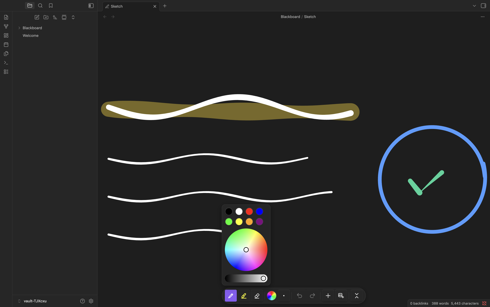
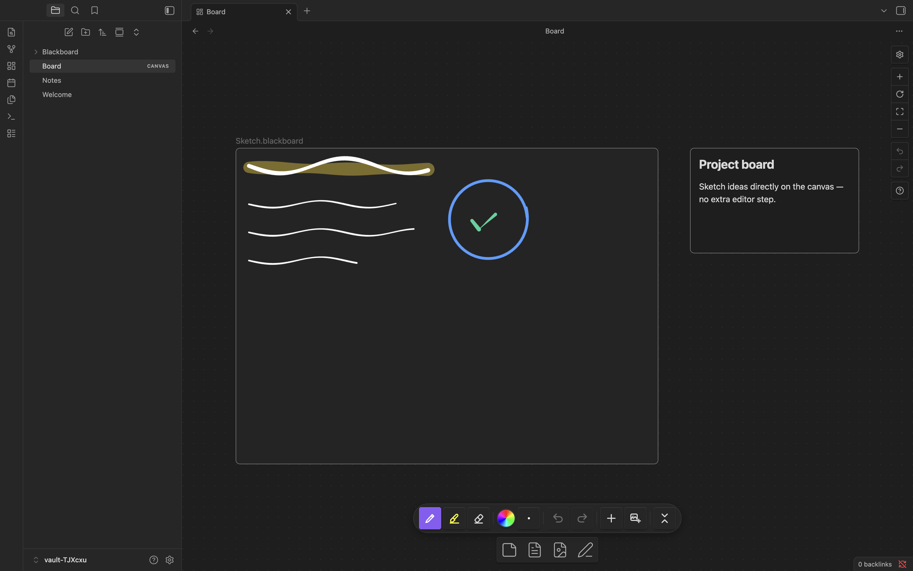
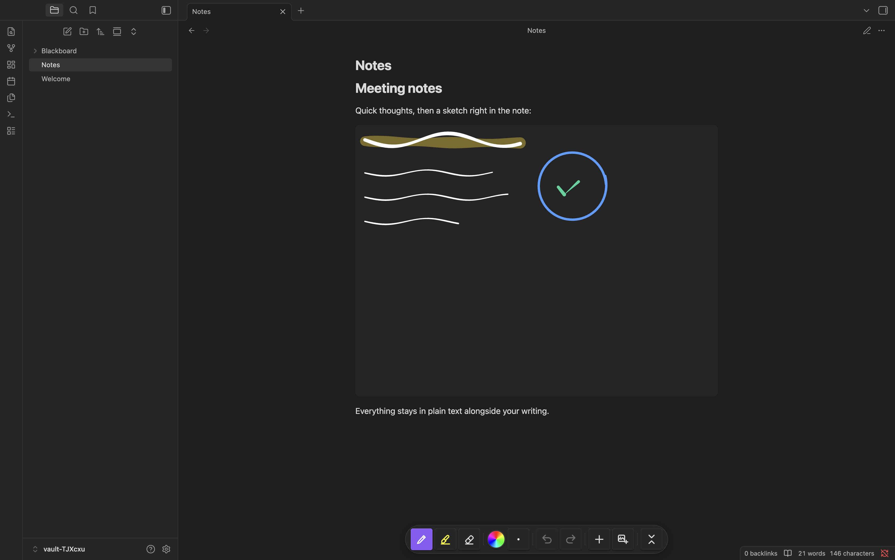
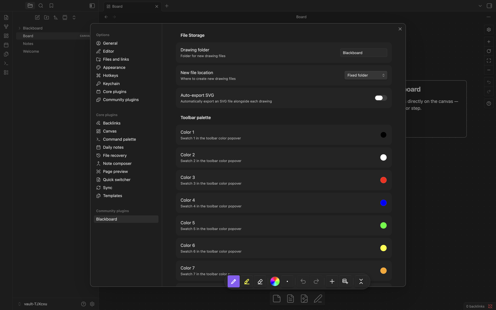

# Blackboard

Native stylus and Apple Pencil drawing for Obsidian.

Blackboard adds a `.blackboard` file type with pressure-sensitive freehand drawing and palm rejection. You draw directly inside Obsidian Canvas nodes and Markdown embeds, with no separate editor to open first. It is built for iPad with Apple Pencil and also works on desktop with a mouse.

<p align="center">
  
</p>

## Features

- Pressure-sensitive strokes from Apple Pencil and other styluses, with variable width from [perfect-freehand](https://github.com/steveruizok/perfect-freehand).
- Draw in place. The pen draws as soon as it touches a Canvas node or a Markdown embed (no click to open it first).
- Palm rejection. A stylus always draws and a finger or resting palm never does, so your hand can rest on the screen while you write.
- Touch navigation in the full-page editor: one finger pans and two fingers pinch-zoom the infinite canvas. On desktop, a mouse wheel or trackpad scroll pans, Ctrl/Cmd + scroll zooms, and Space + drag pans.
- Pen, highlighter (semi-transparent) and an eraser that removes whole strokes.
- Blackboard or whiteboard. The board background is one setting: black by default, or set it to white or any other color.
- One floating toolbar follows the active drawing. The tool, color and size carry across every drawing on the page, and the toolbar collapses to a small pill.
- Each embed's display size comes from its host: the Canvas node's size, or the `|WxH` size on a Markdown embed (without one, the embed uses the drawing's own size). A drawing shows at the size it was drawn and only shrinks to fit when it is larger than its frame. Strokes are clipped to the node and never resize it.
- Optional automatic SVG export, written next to each drawing or to one folder.
- `.blackboard` files are plain, human-readable JSON that diffs cleanly in Git.

## How it compares

Blackboard is for fast, native pen drawing inside your notes and canvases. [Excalidraw](https://github.com/zsviczian/obsidian-excalidraw-plugin) is a full diagramming tool, and [Ink](https://github.com/daledesilva/obsidian_ink) is another handwriting plugin. They're built for different things.

| | Blackboard | Excalidraw | Ink |
|---|:--:|:--:|:--:|
| Draw directly on a Canvas node (no open-to-edit step) | ✓ | ✗ | ✗¹ |
| Live drawing in a Markdown embed | ✓ | ✗ | ✓² |
| Strokes reliably persist on reload | ✓ | ✓ | Not always³ |
| Plain-text, Git-diffable files | ✓ | ✗⁴ | ✗⁴ |
| Diagramming: shapes, arrows, text | ✗⁵ | ✓ | ✗ |
| Primary focus | pen drawing | diagramming | handwriting |

<sub>
¹ Ink has no Canvas-node drawing (<a href="https://github.com/daledesilva/obsidian_ink/issues/89">obsidian_ink#89</a>, open as of 0.3.4).<br>
² Ink renders editable drawings in Markdown embeds today.<br>
³ Ink drawings can disappear on reload (<a href="https://github.com/daledesilva/obsidian_ink/issues/125">obsidian_ink#125</a>, open as of 0.3.4).<br>
⁴ Excalidraw stores drawing data compressed by default and Ink stores the tldraw document model. Blackboard files are plain, human-readable JSON.<br>
⁵ Blackboard has no diagramming tools. When a drawing sits in an Obsidian Canvas, the Canvas itself provides cards, arrows and text alongside it.
</sub>

Need rich diagramming? Use [Excalidraw](https://github.com/zsviczian/obsidian-excalidraw-plugin). It's excellent at it.

## Installation

### Manual

1. Download `main.js`, `manifest.json`, and `styles.css` from the [latest release](https://github.com/jameswolensky/obsidian-blackboard/releases).
2. Create the folder `<vault>/.obsidian/plugins/blackboard/`.
3. Copy the three files into it.
4. Enable **Blackboard** in **Settings > Community plugins**.

### BRAT

1. Install [BRAT](https://github.com/TfTHacker/obsidian42-brat).
2. Choose **Add Beta Plugin** and enter `jameswolensky/obsidian-blackboard`.
3. Enable **Blackboard** in **Settings > Community plugins**.

## Usage

### Create a drawing

Run **Blackboard: New drawing** from the command palette. It creates a `.blackboard` file and opens it in the full-page editor. An empty drawing opens at 1:1, and a drawing with strokes opens at the size it was drawn, centred (a large one shrinks to fit the pane).

### The toolbar

A single floating toolbar follows whichever drawing is active. It holds the pen, highlighter and eraser, a color control (preset swatches plus a color wheel), a brush-size control, undo and redo, buttons to insert a new or existing drawing, and a button that collapses it to a small pill. The pen and highlighter each keep their own color and size, and those choices apply to every drawing on the page (pick a pen color once and it stays as you move between drawings). On a Canvas with no active drawing the collapsed pill stays on screen so there is always a button to add one; everywhere else the toolbar only shows while a drawing is active.



### Embed in a Canvas

1. Open an Obsidian Canvas.
2. Tap the toolbar's **New drawing** button, or run **Blackboard: Insert drawing**. A 400 x 300 drawing node appears in the middle of the view (if a text card is selected, the drawing is embedded in that card instead).
3. Draw on it directly with a stylus. Resizing the node shows more or less of the drawing at the same scale.



### Embed in a Markdown note

Run **Blackboard: Insert drawing**, or right-click in the editor and choose **Insert drawing**, to create a drawing and embed it at the cursor. You can also embed an existing drawing like any file: `![[My Drawing.blackboard]]`. Without a size, the embed uses the drawing's own size, centred, and shrinks to the note's width when it is wider. Set a size with the standard Obsidian syntax, for example `![[My Drawing.blackboard|640x480]]` or `![[My Drawing.blackboard|100%]]`. You draw on the embed directly.



### Export

Turn on **Auto-export SVG** in settings to write an `.svg` copy of each drawing whenever it changes (empty drawings are skipped, and the SVG has a transparent background). Set **SVG export path** to collect the exports in one folder. When the SVG sits next to its drawing, renaming or deleting the drawing renames or deletes the SVG too.

## Commands

| Command | Description |
|---|---|
| New drawing | Create a new `.blackboard` file and open it |
| Insert drawing | Create a drawing and embed it at the cursor in a note, or as a node in the active Canvas |
| Insert existing drawing | Pick an existing `.blackboard` file and embed it at the cursor in a note, or in the active Canvas |

The insert commands need an open note or Canvas. Run from the full-page drawing editor, they show a notice and do nothing.

## Settings



| Setting | Default | Description |
|---|---|---|
| Drawing folder | `Blackboard` | Folder for new drawing files |
| New file location | Fixed folder | Where to create new drawing files |
| Auto-export SVG | Off | Export an SVG copy of each drawing whenever it changes |
| SVG export path | (empty) | Folder for exported SVG files (empty = same folder as drawing) |
| Board background | `#000000` | Color painted behind every drawing (Canvas node, Markdown embed, and the full-page view). Default black; set white for a whiteboard. |
| Color 1 to Color 8 | see below | Swatch 1 to 8 in the toolbar color popover |
| Show toolbar pill | On | Show the collapsed pen-icon pill on Canvas with no active drawing, so there is always a button to add one. Turn off to hide it until a drawing is active. |

New file location offers **Fixed folder** (the drawing folder) or **Same as active file**, and applies to the New drawing command. SVG export path only shows while Auto-export SVG is on. The default toolbar palette is `#000000`, `#ffffff`, `#ff0000`, `#0000ff`, `#00ff00`, `#ffff00`, `#ffa500`, `#800080`. Pen and highlighter colors and sizes, and the eraser size, are picked live from the floating toolbar (they are not settings).

## Compatibility

| Platform | Input | Notes |
|---|---|---|
| iPad + Apple Pencil | Full pressure | Primary target |
| iPad (touch) | Navigation only | In the full-page editor one finger pans and two fingers pinch-zoom. Fingers never draw. |
| Android tablet + stylus | Pressure varies by device | Supported |
| Desktop (mouse) | No pressure (stroke width follows drawing speed) | Supported |

## File format

`.blackboard` files are JSON:

```json
{
  "version": 3,
  "width": 60,
  "height": 50,
  "strokes": [
    {
      "id": "abc123",
      "tool": "pen",
      "color": "#ffffff",
      "size": 2,
      "opacity": 1,
      "points": [[100, 200, 0.5], [101, 201, 0.6]],
      "hasPressure": true,
      "timestamp": 1711281600000
    }
  ],
  "background": { "color": "transparent" },
  "contentBounds": { "x": 80, "y": 180, "width": 60, "height": 50 }
}
```

Each stroke is a list of `[x, y, pressure]` points in drawing space. `width`, `height` and `contentBounds` cache the strokes' bounding box and are recomputed from the strokes on save (an empty drawing saves 800 x 600 and no `contentBounds`). A Canvas node or a sized embed sets its own display size. Files from earlier versions open as they are.

## Development

Requires Node.js 24 and npm.

```bash
npm install
npm run dev      # watch build
npm run build    # production build
npm test         # unit tests (Vitest)
npm run check    # typecheck + lint + tests + build
```

The desktop test runner can't reproduce iPad rendering (Apple WebKit), so I check anything iPad-specific by hand on an iPad.

See [CONTRIBUTING.md](CONTRIBUTING.md) for the contribution workflow and conventions.

## Built with

- [perfect-freehand](https://github.com/steveruizok/perfect-freehand) (MIT): pressure-sensitive stroke geometry
- [iro.js](https://github.com/jaames/iro.js) (MPL-2.0): the color wheel

## License

[MIT](LICENSE) © James Wolensky
